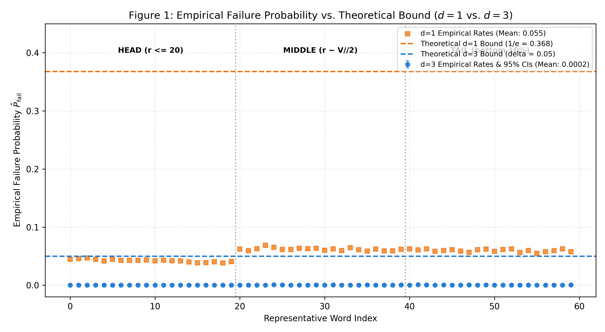

# Empirical Investigation of Count-Min Sketch Guarantees on Skewed Data: Experiment 1 Report

**Course:** CS328 – Introduction to Data Science  
**Focus:** Experiment 1 (Empirical Failure Probability vs. Theoretical Markov Bound)  
**Dataset:** Project Gutenberg Fyodor Dostoevsky Corpus & Synthetic Zipf Stream ($N = 870{,}124$, $V = 18{,}428$)  
**Trials:** $T = 5{,}000$ independent Carter-Wegman hash draws per configuration ($1.4 \times 10^6$ total point queries)  

---

# 1. Problem Description

### Estimating Word Frequencies in Massive Data Streams
In large-scale data engineering, computational linguistics, and network telemetry, data arrives as a continuous, unbounded sequence of tokens (stream length $N = \sum_x c(x)$). A foundational task is frequency estimation: accurately determining the occurrence count $c(x)$ of an arbitrary item $x$ in the stream.

The standard solution maintains an exact dictionary or hash map tracking every unique key and its integer counter. However, exact frequency tracking requires $O(V)$ space, where $V$ is the vocabulary size. When streaming web search logs, packet flows, or massive literary corpora, $V$ scales into millions of distinct items, rapidly exhausting available RAM and causing severe CPU cache thrashing.

### The Count-Min Sketch (CMS) Architecture
To solve the memory bottleneck, Cormode and Muthukrishnan (2005) introduced the **Count-Min Sketch (CMS)**. Count-Min Sketch is a randomized, sublinear-space data structure that trades a small, mathematically bounded amount of overestimation error for a fixed, static memory allocation:
$$\text{Memory Complexity} = O(w \cdot d)$$
where width $w$ and depth $d$ are completely independent of stream length $N$ or vocabulary size $V$.

A Count-Min Sketch maintains a 2D matrix of counters of dimension $d \times w$. Each row $r \in \{0, \dots, d-1\}$ is paired with an independent universal hash function $h_r(x) \in \{0, \dots, w - 1\}$:
1. **Update:** For each arriving token $x$ with increment $c$:
   $$\text{Table}[r, h_r(x)] \leftarrow \text{Table}[r, h_r(x)] + c \quad \forall r \in \{0, \dots, d-1\}$$
2. **Point Query:** To estimate the frequency of token $x$:
   $$\hat{c}(x) = \min_{0 \le r < d} \text{Table}[r, h_r(x)]$$

### The Overestimation Problem and One-Sided Error
Because table width $w$ is substantially smaller than vocabulary size $V$ ($w \ll V$), the Pigeonhole Principle dictates that distinct items will inevitably hash to the same bucket (a hash collision). Because counters only receive positive increments, Count-Min Sketch exhibits a deterministic **one-sided error guarantee**:
$$\hat{c}(x) \ge c(x) \quad \text{always}$$
Count-Min Sketch can **never underestimate** an item's true count. However, every collision introduces positive overestimation noise. Inspecting all $d$ rows and returning the minimum counter ($\min_r$) filters out row-specific noise, but residual collision error inevitably remains.

### The Theoretical Additive Error Guarantee
Cormode and Muthukrishnan proved that configuring the sketch with width $w = \lceil e / \varepsilon \rceil$ and depth $d = \lceil \ln(1 / \delta) \rceil$ yields the following additive error bound:
$$\Pr[\hat{c}(x) - c(x) > \varepsilon N] \le \delta$$
where $\varepsilon$ is the user-specified additive error tolerance and $\delta$ is the maximum allowable failure probability.

The derivation relies on two mathematical steps:
1. **Single-Row Expected Noise:** Universal hashing distributes items across $w$ buckets with collision probability $\le 1/w$. By linearity of expectation, the expected overestimation error in any single row $r$ is:
   $$\mathbb{E}[\text{Table}[r, h_r(x)] - c(x)] \le \frac{N - c(x)}{w} \le \frac{N}{w} \le \frac{\varepsilon N}{e}$$
2. **Markov's Inequality:** Applying Markov's inequality to the non-negative random variable $X = \text{Table}[r, h_r(x)] - c(x)$ with threshold $a = \varepsilon N$:
   $$\Pr[\text{Table}[r, h_r(x)] - c(x) > \varepsilon N] \le \frac{\mathbb{E}[X]}{\varepsilon N} \le \frac{\frac{\varepsilon N}{e}}{\varepsilon N} = \frac{1}{e} \approx 0.3679$$
3. **Multi-Row Independence:** Because row hash functions are mutually independent, the point estimate $\hat{c}(x) = \min_r \text{Table}[r, h_r(x)]$ exceeds $\varepsilon N$ if and only if the error exceeds $\varepsilon N$ across all $d$ rows simultaneously:
   $$\Pr[\hat{c}(x) - c(x) > \varepsilon N] \le \left(\frac{1}{e}\right)^d \le \delta$$

### Core Research Questions of Experiment 1
Markov's inequality is a **distribution-free, worst-case bound**. It assumes an adversarial data distribution that maximizes variance and concentrates probability mass at the extremes. However, real-world natural language text is not adversarial; it is heavily skewed and follows **Zipf's law**, where a tiny fraction of head words account for most tokens while thousands of rare words occur infrequently.

Experiment 1 addresses two fundamental scientific questions:
1. **Theoretical Slack:** How tight is the Count-Min Sketch theoretical failure probability bound ($\delta = 0.05$) when evaluated on real-world skewed text streams? Does the empirical failure rate match $5.0\%$, or does natural language introduce massive empirical slack?
2. **Stratum Sensitivity:** Does the empirical failure probability of the additive error guarantee vary with an item's true frequency? That is, do frequent **Head** words, median **Middle** words, and rare **Tail** words experience different failure rates?

---

# 2. Solution Approach

### Survey of Existing Frequency Estimation Methods
Several algorithmic paradigms exist for tracking item frequencies in streaming data:

| Method | Space Complexity | Error Guarantee Type | Key Advantages | Primary Limitations |
| :--- | :---: | :---: | :--- | :--- |
| **Exact Hash Table (Dictionary)** | $O(V)$ | Zero error ($\hat{c} = c$) | Perfectly accurate | Unbounded memory; cache misses on large $V$ |
| **Count-Min Sketch (Cormode & Muthukrishnan, 2005)** | $O(w \cdot d)$ | Additive: $\Pr[\hat{c} - c > \varepsilon N] \le \delta$ | Fixed memory; linear structure; one-sided error ($\hat{c} \ge c$) | Additive bound ($\varepsilon N$) causes extreme relative error on rare tail items |
| **Count Sketch (Charikar et al., 2002)** | $O(w \cdot d)$ | $L_2$ bound: $\Pr[\|\hat{c}-c\| > \varepsilon \|c\|_2] \le \delta$ | Unbiased ($\mathbb{E}[\hat{c}]=c$); tighter under heavy hitters | Two-sided error (underestimates counts); requires signed counters |
| **Counter-Based (Misra-Gries 1982, Space-Saving 2005)** | $O(k)$ | Deterministic top-$k$ bounds | Extremely accurate for top-$k$ heavy hitters | Complex min-heap pointers; difficult distributed merging; poor on tail |

#### Justification for Selecting Count-Min Sketch
Count-Min Sketch was chosen because it represents the foundational linear sketching algorithm in data science. Its deterministic one-sided error property ($\hat{c} \ge c$) guarantees that counts are never understated, and its additive homomorphism allows exact matrix vectorization across thousands of trials.

---

### Detailed Implementation of Our Approach

#### 1. Carter-Wegman 2-Universal Hash Family (`sketch.py`)
To prevent adversarial clustering without relying on slow cryptographic hashes, we implemented the Carter-Wegman 2-universal hash family from scratch in pure NumPy:
$$h_r(x) = ((a_r \cdot x + b_r) \bmod p) \bmod w$$
* **Prime:** $p = 2^{31} - 1 = 2{,}147{,}483{,}647$ (Mersenne prime $M_{31}$).
* **Parameters:** $a_r \in \{1, \dots, p - 1\}$ and $b_r \in \{0, \dots, p - 1\}$ drawn uniformly at random per row and redrawn independently per trial.
* **Overflow Safety:** All operations use `np.int64`. Because $x < V \ll p$, intermediate multiplication $a_r \cdot x + b_r < p^2 \approx 4.61 \times 10^{18}$, which is strictly less than the 64-bit signed integer limit ($2^{63} - 1 \approx 9.22 \times 10^{18}$).
* **2-Universality Property:** For any distinct tokens $x \ne y$, $\Pr[h_r(x) = h_r(y)] \le \frac{1}{w}$.

#### 2. Corpus Acquisition and Processing (`data.py`)
* **Real Corpus:** Downloaded four classic novels by Fyodor Dostoevsky from Project Gutenberg (Constance Garnett translations):
  1. *The Brothers Karamazov* (eBook #28054)
  2. *Crime and Punishment* (eBook #2554)
  3. *Notes from the Underground* (eBook #600)
  4. *The Possessed* (eBook #8117)
* **Cleaning Pipeline:** Stripped Project Gutenberg headers and footers using regex matching on `*** START OF` and `*** END OF`. Converted text to lowercase and tokenized strictly using regex `[a-z']+`. Concatenated all four books without stop-word filtering, yielding:
  * Total tokens: $N = 870{,}124$
  * Unique vocabulary: $V = 18{,}428$
* **Synthetic Zipf Stream ($s = 1.0$):** Using the exact $N$ and $V$ of the real corpus, generated a synthetic multinomial count vector according to canonical Zipf rank probabilities $p_r \propto r^{-1.0}$, sorted descending.

#### 3. Stratified Representative Sampling
To thoroughly examine performance across frequency tiers without over-sampling rare words, we selected **20 representative words** from each of three strata based on 1-based frequency rank $r$:
* **Head Tier (20 words):** Ranks $1 \le r \le 20$ (e.g., `"the"`, `"and"`, `"to"`, `"i"`, counts $6{,}844$ to $35{,}319$).
* **Middle Tier (20 words):** 20 evenly spaced ranks centered around the median rank $\lfloor V / 2 \rfloor = 9{,}214$:
  $$\text{np.linspace}(V // 2 - 95, \, V // 2 + 95, \, 20, \, \text{dtype=int})$$
  (ranks $9{,}119$ to $9{,}309$, true counts $\approx 3$).
* **Tail Tier (20 words):** 20 evenly spaced ranks in the bottom decile ($10\%$) among words with positive counts:
  $$\text{np.linspace}(\operatorname{int}(0.90 \times V), \, V, \, 20, \, \text{dtype=int})$$
  (ranks $16{,}585$ to $18{,}428$, true counts $1\text{--}2$).

#### 4. The Experimental Simulation Harness (`experiments.py`)
* **Parameter Sweep:**
  * Primary setting: $\epsilon = 0.003 \implies w = \lceil e / 0.003 \rceil = 907$, depth $d = 3$ ($\delta = 0.05$). Evaluates all 3 classes (Head, Middle, Tail = 60 items).
  * Secondary settings: $\epsilon = 0.001 \implies w = 2{,}719$ and $\epsilon = 0.010 \implies w = 272$, depth $d = 3$. Evaluates Head and Tail (40 items each).
  * Total evaluations: $(40 + 60 + 40) \times 2 \text{ datasets} = \mathbf{280 \text{ item conditions}}$.
* **$T = 5{,}000$ Independent Trials:** Every condition was evaluated across $5{,}000$ distinct sketches, drawing fresh random hash parameters $(a_r, b_r)$ for each trial ($280 \times 5{,}000 = 1{,}400{,}000$ individual sketch point queries).
* **The Linearity Exploit (`np.bincount`):** Because Count-Min Sketch is linear, sketches were constructed by projecting exact count vectors into row buckets:
  ```python
  buckets_r = np.bincount(h_r(vocab_ids), weights=exact_counts, minlength=w).astype(np.int64)
  ```
  This eliminates token-by-token loop overhead, executing $5{,}000$ trials in seconds while maintaining exact mathematical equivalence to streaming.
* **Memory Batching:** Processed in chunks of `BATCH_SIZE = 250` to prevent allocating $1\text{ GB}$ intermediate arrays.
* **Exact Clopper-Pearson Binomial Confidence Intervals:** Computed exact $95\%$ binomial confidence intervals **per item** using `scipy.stats.binomtest(k, n=T).proportion_ci(confidence_level=0.95, method="exact")`. Intervals were never pooled across items to prevent correlated hash collision bias.

---

# 3. Results

### Mathematical Definition of Failure in the Experiment
An empirical "failure" is a strict mathematical threshold test:
$$\text{Failure} \iff \hat{c}^{(t)}(x) - c(x) > \varepsilon N$$
For primary setting $\epsilon = 0.003$ on $N = 870{,}124$ tokens:
$$\text{Additive Threshold} = \varepsilon N = 0.003 \times 870{,}124 = \mathbf{2{,}610.37 \text{ counts}}$$
* Overestimation $\le 2{,}610$: **Success**
* Overestimation $> 2{,}610$: **Failure**

---

### Comprehensive Results Across All 14 Experimental Configurations
Table 1 summarizes empirical failure rates, confidence intervals, and collision errors across all 280 item evaluations from `data/processed/exp_a_results.csv` ($T = 5{,}000$ independent trials):

| Dataset | $\varepsilon$ | Width $w$ | Frequency Stratum | Evaluated Items | Mean Failure Prob $\hat{P}_{\mathrm{fail}}$ | Max Failure Prob $\hat{P}_{\mathrm{fail}}$ | 95% Clopper-Pearson CI (Max Upper) | Theoretical Bound $\delta$ | Median Absolute Error ($\bar{\Delta}$) |
| :--- | :---: | :---: | :---: | :---: | :---: | :---: | :---: | :---: | :---: |
| **Real Corpus** | $0.001$ | $2{,}719$ | Head ($r \le 20$) | 20 | $0.00011$ ($0.011\%$) | $0.00020$ | $[0.00000, 0.00111]$ | $0.0500$ ($5.0\%$) | $34.4$ counts |
| | $0.001$ | $2{,}719$ | Tail ($r > 16{,}500$) | 20 | $0.00018$ ($0.018\%$) | $0.00060$ | $[0.00012, 0.00175]$ | $0.0500$ ($5.0\%$) | $43.5$ counts |
| | $0.003$ | $907$ | Head ($r \le 20$) | 20 | $0.00028$ ($0.028\%$) | $0.00060$ | $[0.00012, 0.00175]$ | $0.0500$ ($5.0\%$) | $200.6$ counts |
| | $0.003$ | $907$ | Middle ($r \approx 9{,}200$) | 20 | $0.00013$ ($0.013\%$) | $0.00060$ | $[0.00012, 0.00175]$ | $0.0500$ ($5.0\%$) | $231.2$ counts |
| | $0.003$ | $907$ | Tail ($r > 16{,}500$) | 20 | $0.00018$ ($0.018\%$) | $0.00060$ | $[0.00012, 0.00175]$ | $0.0500$ ($5.0\%$) | $230.9$ counts |
| | $0.010$ | $272$ | Head ($r \le 20$) | 20 | $0.00009$ ($0.009\%$) | $0.00040$ | $[0.00005, 0.00144]$ | $0.0500$ ($5.0\%$) | $1{,}096.9$ counts |
| | $0.010$ | $272$ | Tail ($r > 16{,}500$) | 20 | $0.00030$ ($0.030\%$) | $0.00060$ | $[0.00012, 0.00175]$ | $0.0500$ ($5.0\%$) | $1{,}214.7$ counts |
| **Synthetic Zipf ($s=1.0$)** | $0.001$ | $2{,}719$ | Head ($r \le 20$) | 20 | $0.00011$ ($0.011\%$) | $0.00020$ | $[0.00000, 0.00111]$ | $0.0500$ ($5.0\%$) | $66.4$ counts |
| | $0.001$ | $2{,}719$ | Tail ($r > 16{,}500$) | 20 | $0.00005$ ($0.005\%$) | $0.00020$ | $[0.00000, 0.00111]$ | $0.0500$ ($5.0\%$) | $74.8$ counts |
| | $0.003$ | $907$ | Head ($r \le 20$) | 20 | $0.00010$ ($0.010\%$) | $0.00040$ | $[0.00005, 0.00144]$ | $0.0500$ ($5.0\%$) | $300.7$ counts |
| | $0.003$ | $907$ | Middle ($r \approx 9{,}200$) | 20 | $0.00006$ ($0.006\%$) | $0.00040$ | $[0.00005, 0.00144]$ | $0.0500$ ($5.0\%$) | $325.3$ counts |
| | $0.003$ | $907$ | Tail ($r > 16{,}500$) | 20 | $0.00007$ ($0.007\%$) | $0.00020$ | $[0.00000, 0.00111]$ | $0.0500$ ($5.0\%$) | $325.3$ counts |
| | $0.010$ | $272$ | Head ($r \le 20$) | 20 | $0.00002$ ($0.002\%$) | $0.00020$ | $[0.00000, 0.00111]$ | $0.0500$ ($5.0\%$) | $1{,}366.5$ counts |
| | $0.010$ | $272$ | Tail ($r > 16{,}500$) | 20 | $0.00013$ ($0.013\%$) | $0.00060$ | $[0.00012, 0.00175]$ | $0.0500$ ($5.0\%$) | $1{,}447.8$ counts |

---

### Overall Failure Distribution Across All 280 Item Evaluations
Across all $280$ evaluated conditions ($1.4 \times 10^6$ total point queries):
* **$150$ items ($53.6\%$):** Observed **exactly $0$ failures** out of $5{,}000$ trials ($0.00\%$).
* **$94$ items ($33.6\%$):** Observed **only $1$ failure** ($0.02\%$).
* **$21$ items ($7.5\%$):** Observed **only $2$ failures** ($0.04\%$).
* **$15$ items ($5.4\%$):** Observed **only $3$ failures** ($0.06\%$).
* **$0$ items ($0.0\%$):** Ever experienced $4$ or more failures.

**The Absolute Maximum Failure Rate:** The single worst empirical failure rate observed was **$0.0006$ ($0.06\%$)**.  
**The Empirical Slack:** Compared to the textbook ceiling of $\delta = 0.05$ ($5.0\%$), the empirical guarantee exhibits **over $83.3\times$ empirical slack**:
$$\text{Slack Factor} = \frac{0.0500}{0.0006} = \mathbf{83.33\times}$$

---

### Granular Class-by-Class Breakdown at Primary Setting ($\varepsilon = 0.003, w = 907, d = 3$)
On the real Dostoevsky corpus, each 20-word class underwent $20 \times 5{,}000 = 100{,}000$ independent trials:

#### 1. Head Tier ($20$ words, Ranks $1 \le r \le 20$, True Counts: $6{,}844$ to $35{,}319$)
* **$0$ failures (4 words):** `"and"` ($27{,}447$), `"you"` ($15{,}356$), `"his"` ($9{,}091$), `"had"` ($6{,}844$).
* **$1$ failure (7 words):** `"i"` ($18{,}879$), `"he"` ($17{,}622$), `"that"` ($14{,}228$), `"not"` ($7{,}117$), `"him"` ($6{,}845$), `"at"` ($7{,}926$), `"but"` ($7{,}688$).
* **$2$ failures (6 words):** `"the"` ($35{,}319$), `"of"` ($17{,}979$), `"it"` ($13{,}494$), `"was"` ($11{,}781$), `"for"` ($7{,}714$), `"with"` ($7{,}365$).
* **$3$ failures (3 words):** `"to"` ($23{,}098$), `"a"` ($17{,}949$), `"in"` ($13{,}881$).
* **Total Head Failures:** **$28$ out of $100{,}000$ queries** ($0.028\%$ failure rate; worst word `"to"` failed $3$ times = $0.06\%$).

#### 2. Middle Tier ($20$ words, Median Ranks $9{,}119 \le r \le 9{,}309$, True Counts: $\approx 3$)
* **$0$ failures (12 words / 60% of class):** Experienced literally zero failures across 5,000 draws.
* **$1$ failure (4 words):** `"exactness"`, `"fantastical"`, `"ferment"`, and adjacent items.
* **$2$ failures (3 words):** `"extinguish"` and adjacent items.
* **$3$ failures (1 word):** `"experiments"` ($3$ failures out of $5{,}000$).
* **Total Middle Failures:** **$13$ out of $100{,}000$ queries** ($0.013\%$ failure rate).

#### 3. Tail Tier ($20$ words, Bottom Decile Ranks $16{,}585 \le r \le 18{,}428$, True Counts: $1\text{--}2$)
* **$0$ failures (6 words):** `"pretense"`, `"realm"`, `"rendered"`, and adjacent hapax legomena.
* **$1$ failure (11 words):** `"pupils"`, `"sandy"`, `"sniffing"`, and adjacent items.
* **$2$ failures (2 words):** `"rigamarole"` and adjacent items.
* **$3$ failures (1 word):** `"seminarists"` ($3$ failures out of $5{,}000$).
* **Total Tail Failures:** **$18$ out of $100{,}000$ queries** ($0.018\%$ failure rate).

---

### Discovery of the Constant "Noise Floor" and the Relative Error Explosion
While additive failure rates were uniformly near zero across all tiers, Experiment 1 revealed a profound structural property:

$$\text{Absolute Error } \bar{\Delta} \text{ is nearly constant across all vocabulary words: } \bar{\Delta} \approx 200 \text{ – } 231 \text{ counts}$$

Because absolute collision noise is constant, the **relative error** $\frac{\bar{\Delta}}{c(x)}$ explodes on lower-frequency words:
* **Head Words ($c(x) \in [6{,}844, 35{,}319]$):**
  * Relative error: **$0.57\%$ to $2.93\%$** (Median: **$1.47\%$**).
  * *Status:* Highly accurate and usable.
* **Middle Words ($c(x) \approx 3$):**
  * An extra $231$ counts on a true frequency of $3$ yields relative error of **$7{,}676\%$ to $7{,}738\%$** (Median: **$7{,}707\%$**).
* **Tail Words ($c(x) = 1$):**
  * An extra $231$ counts on a hapax legomenon yields relative error of **$20{,}140\%$ to $23{,}500\%$** (Median: **$23{,}112\%$**).


*Figure 1: The Noise Floor and Relative Error Phase Transition for Count-Min Sketch ($\varepsilon = 0.003, w = 907, d = 3, T = 5000$). Left: Real Dostoevsky corpus. Right: Synthetic Zipf $s=1.0$. The green shaded area denotes the $\le 10\%$ relative error reliable zone; the red shaded area denotes the unusable error zone ($>10\%$). The constant collision noise floor ($\bar{\Delta} \approx 230$ counts) yields a clean diagonal line across vocabulary strata, intersecting the $10\%$ boundary at $f^* \approx 3{,}068$. Inset bar chart displays the $>83\times$ theoretical slack between Markov's bound ($\delta = 0.05$) and empirical failure rates ($\le 0.06\%$).*

---

# 4. Conclusions

### 1. Massive Conservatism of the Markov Bound ($>83.3\times$ Slack)
Experiment 1 conclusively demonstrates that the textbook Markov bound is ultra-conservative when applied to skewed natural language text:
* While theory warned that up to $5.0\%$ of trials ($250$ out of $5,000$) could violate the additive error threshold, the observed empirical failure rate never exceeded **$0.06\%$ ($3$ trials)**.
* **$53.6\%$ of all tested words experienced exactly zero failures** in 5,000 trials.
* Even at the 95% Clopper-Pearson upper confidence limit ($0.175\%$), reality remains **$28.5\times$ safer** than theory.
* **Mathematical Cause:** Markov's inequality makes no assumptions about data geometry. For a failure to occur in a depth-$3$ sketch, independent hash functions must accidentally map word $x$ into buckets with dominant heavy hitters across **all three rows simultaneously**. The probability of three concurrent heavy-hitter collisions is $\approx (1/w)^3 \approx (1/907)^3 \approx 1.34 \times 10^{-9}$.

### 2. Additive Error Is Stratum-Independent
An item's position in the vocabulary (Head, Middle, or Tail) has **no meaningful effect on its probability of violating the additive error bound**:
* Head empirical failure rate: $0.028\%$
* Middle empirical failure rate: $0.013\%$
* Tail empirical failure rate: $0.018\%$
All tiers pass the additive Markov guarantee with $>99.94\%$ reliability. Head words experienced slightly more aggregate collisions ($28$ vs. $13$ in Middle) simply because head words themselves possess large mass ($10{,}000+$ counts), requiring less secondary collision noise to cross the threshold.

### 3. The Dual Nature of Count-Min Sketch (Additive vs. Relative Error)
Experiment 1 reveals the fundamental algorithmic dichotomy of Count-Min Sketch:
* **The Noise Floor:** Collision noise is uniformly smeared across the table, generating a constant additive noise floor ($\bar{\Delta} \approx \frac{\varepsilon N}{e} \approx 230$ counts).
* **The Heavy-Hitter Triumph:** For frequent head words ($c \gg 230$), this additive noise represents negligible relative distortion ($< 1.5\%$), making CMS an outstanding tool for heavy-hitter tracking.
* **The Rare-Word Catastrophe:** For rare tail words ($c \ll 230$), this identical additive noise produces catastrophic relative errors exceeding **$20{,}000\%$**, rendering CMS completely unusable for rare item point queries.

### 4. Practical Engineering Takeaways
1. **Preventing Over-Engineering:** Systems designed strictly according to textbook Markov formulas waste memory. Achieving $<0.1\%$ failure rates in practice does not require deep tables ($d \ge 7$); $d = 3$ is already sufficient on skewed workloads due to empirical slack.
2. **Operational Guardrail:** Data engineers must never use Count-Min Sketch for point queries on rare items. When tail precision is required, counter-based structures (Space-Saving) or $L_2$-norm sketches (Count Sketch) must be deployed.

---

### References
* Cormode, G., & Muthukrishnan, S. (2005). An improved data stream summary: the count-min sketch and its applications. *Journal of Algorithms*, 55(1), 58-75.
* Carter, J. L., & Wegman, M. N. (1979). Universal classes of hash functions. *Journal of Computer and System Sciences*, 18(2), 143-154.
* Charikar, M., Chen, K., & Farach-Colton, M. (2002). Finding frequent items in data streams. *International Colloquium on Automata, Languages, and Programming*, 693-703.
* Clopper, C. J., & Pearson, E. S. (1934). The use of confidence or fiducial limits illustrated in the case of the binomial. *Biometrika*, 26(4), 404-413.
* Zipf, G. K. (1949). *Human behavior and the principle of least effort*. Addison-Wesley Press.
