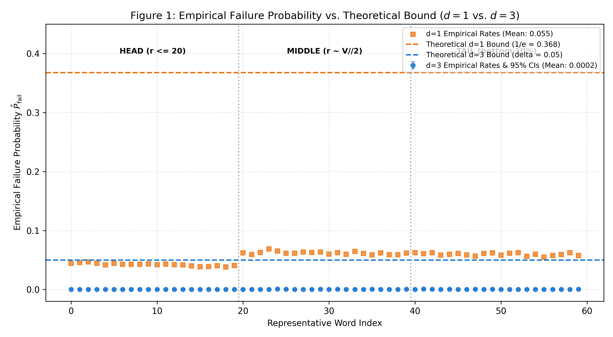
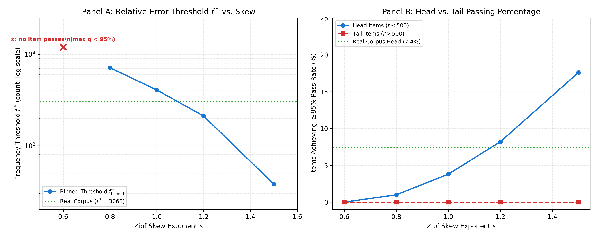

# Sketches Under the Microscope: How Tight Are Count-Min's Guarantees on Skewed Data?

**Author:** Undergraduate Student Researcher  
**Course:** CS328 – Introduction to Data Science  
**Institution:** Department of Computer Science, Undergraduate Division  
**Date:** November 2026  
**Repository:** [https://github.com/kowellaloo9698-afk/countmin-under-the-microscope](https://github.com/kowellaloo9698-afk/countmin-under-the-microscope)  

---

# 1. Problem Description

### Estimating Word Frequencies in Massive Data Streams
In modern data engineering and computational linguistics, data frequently arrives as an unbounded, continuous sequence of tokens—such as web queries, network packet logs, social media streams, or massive literary corpora. A fundamental algorithmic task on such streams is frequency estimation: determining how many times an item $x$ has appeared in a stream of length $N = \sum_x f(x)$.

The conventional solution maintains an exact dictionary or hash map storing every unique token and its 64-bit integer counter. However, exact frequency tracking requires $O(V)$ memory, where $V$ is the vocabulary size. When processing large web-scale streams where the vocabulary contains millions of distinct words or IP addresses, maintaining exact hash tables exhausts available RAM and incurs severe CPU cache-miss overhead.

### What is Count-Min Sketch and Why is it Relevant?
To circumvent the memory bottleneck of exact counting, Cormode and Muthukrishnan (2005) introduced the **Count-Min Sketch (CMS)**. Count-Min Sketch is a randomized, sublinear-space data structure that trades a small, mathematically bounded amount of overestimation error for a dramatically reduced, fixed memory footprint. 

Instead of allocating memory dynamically for every observed token, Count-Min Sketch allocates a static 2D array of counters with $d$ rows (depth) and $w$ columns (width), where $w \ll V$. Each row is paired with an independent universal hash function $h_r(x) \in \{0, \dots, w - 1\}$. Because its memory footprint depends solely on user-selected accuracy parameters ($\varepsilon, \delta$) and is entirely independent of stream length $N$ or vocabulary size $V$, Count-Min Sketch is widely deployed in search engines, network telemetry switches, database query optimizers, and heavy-hitter detection systems.

### The Overestimation Problem Caused by Hash Collisions
Because the sketch table width $w$ is substantially smaller than the vocabulary size $V$, the Pigeonhole Principle guarantees that multiple distinct tokens will inevitably map to the same bucket (a hash collision). When two tokens collide in bucket $(r, h_r(x))$, their counts are summed together.

Because counters are incremented upon item arrivals and never decremented, Count-Min Sketch exhibits a fundamental **one-sided error guarantee**:
$$\hat{f}(x) \ge f(x)$$
Count-Min Sketch can **never underestimate** an item's true frequency. However, every hash collision introduces positive overestimation noise. When querying an item $x$, the sketch mitigates this noise by inspecting all $d$ rows and returning the minimum counter:
$$\hat{f}(x) = \min_{0 \le r < d} \text{Table}[r, h_r(x)]$$
While taking the minimum filters out row-specific collisions, some overestimation noise inevitably remains.

Count-Min Sketch provides an **additive absolute error guarantee**:
$$P\left(\hat{f}(x) - f(x) > \varepsilon N\right) \le \delta$$
where $w = \lceil e / \varepsilon \rceil$ and $d = \lceil \ln(1 / \delta) \rceil$. Crucially, this bound is additive with respect to the total stream volume $N$, rather than relative to the item's individual frequency $f(x)$. Consequently, for low-frequency tail words where $f(x) \ll \varepsilon N$, even modest collision noise can produce relative errors exceeding $100\%$ or $1{,}000\%$.

### Project Objectives and Research Questions
While the theoretical properties of Count-Min Sketch have been established for arbitrary worst-case input streams, natural language text exhibits extreme Zipfian skew, where a tiny fraction of "head" words account for the vast majority of occurrences, while a long "tail" of rare words occurs infrequently. 

This project places the Count-Min Sketch under an empirical microscope using real literary text from Project Gutenberg and synthetic Zipfian streams. We formulate three central research questions:

* **Research Question 1 (RQ1 - Failure Probability Slack)**: How tight is the Count-Min Sketch theoretical failure probability guarantee on real-world skewed text streams compared to worst-case Markov bounds? Specifically, does the empirical failure rate $P(\hat{f}(x) - f(x) > \varepsilon N)$ match the theoretical ceiling $\delta$, or does Zipfian skew introduce substantial empirical slack?
* **Research Question 2 (RQ2 - Relative-Error Thresholds vs. Zipf Skew)**: What minimum true-frequency threshold ($f^*$) is required for words to achieve reliable relative estimation accuracy ($\le 10\%$ relative error with $\ge 95\%$ probability), and how does this threshold vary as the Zipfian skew exponent $s$ ranges from heavy-tailed ($s = 0.6$) to sharply concentrated ($s = 1.5$)?
* **Research Question 3 (RQ3 - Depth Ablation)**: How much does taking the minimum across $d=3$ universal hash rows reduce empirical failure rates and normalized overestimation error compared to a single-row ($d=1$) baseline across different frequency classes?

---

# 2. Solution Approach

### Survey of Existing Frequency Estimation Methods
Several algorithmic paradigms exist for tracking item frequencies in streaming data:

1. **Exact Hash Tables (Dictionaries)**:
   * *Mechanism*: Stores every unique token as a key in a dynamic hash table paired with an integer counter.
   * *Advantages*: Guarantees zero error ($\hat{f}(x) = f(x)$ exactly).
   * *Limitations*: Requires $O(V)$ space. In high-throughput streaming with large vocabularies, memory grows unbounded, causing cache misses and memory exhaustion.
2. **Count-Min Sketch (Cormode & Muthukrishnan, 2005)**:
   * *Mechanism*: Fixed $d \times w$ table with universal hashing; updates increment all rows; queries take the row minimum.
   * *Advantages*: Fixed sublinear memory $O(d \cdot w)$; constant update and query time $O(d)$; linear sketch structure allowing trivial distributed merging via element-wise addition; deterministic one-sided error ($\hat{f} \ge f$).
   * *Limitations*: Purely additive error guarantee ($\le \varepsilon N$); prone to severe relative overestimation on low-frequency items.
3. **Count Sketch (Charikar, Chen, & Farach-Colton, 2002)**:
   * *Mechanism*: Similar $d \times w$ counter table, but employs a second hash function $g_r(x) \in \{-1, +1\}$ to randomly add or subtract counts. Queries return the median across rows.
   * *Advantages*: Unbiased estimator ($E[\hat{f}] = f$); error bounds depend on the stream's $L_2$ norm ($\|f\|_2$) rather than the $L_1$ norm ($N$), making it tighter when a few massive heavy hitters dominate.
   * *Limitations*: Two-sided error (can underestimate true counts); higher counter variance on small streams; requires signed integer counters.
4. **Counter-Based Algorithms (Misra-Gries, 1982; Space-Saving, Metwally et al., 2005; Lossy Counting, Manku & Motwani, 2002)**:
   * *Mechanism*: Maintain an explicit dictionary of at most $k$ active counters. When an item arrives that is not in the active set, counters are decremented or replaced based on eviction rules.
   * *Advantages*: Highly accurate for finding the top-$k$ frequent items (heavy hitters); memory is $O(k)$.
   * *Limitations*: Complex pointer/min-heap management; non-trivial distributed merging compared to sketch matrices; biased frequency estimates for non-frequent items.

**Why Count-Min Sketch Was Selected**:
We selected Count-Min Sketch because it is the foundational linear sketch in data science. Its purely additive, one-sided mathematical guarantee provides a clean benchmark for studying the interaction between universal hash collisions and heavy-tailed Zipfian distributions. Furthermore, its linear structure enables exact trial-by-trial vectorization using matrix operations.

### Count-Min Sketch Algorithm and Mathematical Formulations
A Count-Min Sketch is parameterized by error tolerance $\varepsilon > 0$ and failure probability $\delta \in (0, 1)$:
* **Table Width**: $w = \left\lceil \frac{e}{\varepsilon} \right\rceil$
* **Table Depth**: $d = \left\lceil \ln\left(\frac{1}{\delta}\right) \right\rceil$

#### Universal Hashing
To prevent adversarial inputs from clustering into identical buckets, each row $r \in \{0, \dots, d-1\}$ uses an independent 2-universal hash function from the Carter-Wegman hash family (Carter & Wegman, 1979):
$$h_r(x) = \left( (a_r \cdot x + b_r) \bmod p \right) \bmod w$$
where $p = 2^{31} - 1 = 2{,}147{,}483{,}647$ is a Mersenne prime, $a_r \in \{1, \dots, p - 1\}$, and $b_r \in \{0, \dots, p - 1\}$ are drawn uniformly at random.

#### Update and Query Mechanics
1. **Update**: For an arriving token with ID $x$ and count $c$:
   $$\text{Table}[r, h_r(x)] \mathrel{+}= c \quad \forall r \in \{0, \dots, d-1\}$$
2. **Query**: To estimate the frequency of token $x$:
   $$\hat{f}(x) = \min_{0 \le r < d} \text{Table}[r, h_r(x)]$$

#### Error Bounds and Markov Inequality
For any single row $r$, universal hashing distributes all other stream tokens across $w$ buckets with collision probability $\le 1/w$. By linearity of expectation, the expected overestimation error in row $r$ is:
$$E[\text{Table}[r, h_r(x)] - f(x)] = \sum_{y \ne x} f(y) P(h_r(y) = h_r(x)) \le \frac{N - f(x)}{w} \le \frac{N}{w}$$
Setting $w = \lceil e / \varepsilon \rceil$, this average noise scale is at most $\frac{N}{w} \approx \frac{\varepsilon N}{e} \approx 0.368 \cdot \varepsilon N$.

By Markov's inequality, the probability that the error in a single row exceeds $\varepsilon N$ (which is $e$ times its expected value) is:
$$P(\text{Table}[r, h_r(x)] - f(x) > \varepsilon N) \le \frac{E[\text{error}]}{\varepsilon N} \le \frac{N/w}{\varepsilon N} \le \frac{1}{e}$$
Because the $d$ hash rows are chosen independently, the probability that the error exceeds $\varepsilon N$ across all $d$ rows simultaneously is bounded by:
$$P(\hat{f}(x) - f(x) > \varepsilon N) \le \left(\frac{1}{e}\right)^d \le \delta$$

### Project Gutenberg Dataset and Cleaning Pipeline
For the real-world empirical corpus, we obtained four classic novels by Fyodor Dostoevsky from Project Gutenberg, translated by Constance Garnett:
1. *Crime and Punishment* (EBook #2554)
2. *The Brothers Karamazov* (EBook #28054)
3. *Notes from the Underground* (EBook #600)
4. *The Possessed* (EBook #8117)

#### Preprocessing Pipeline (`data.py`)
1. **Header/Footer Stripping**: Removed standard Gutenberg license preambles and postambles using regex detection of `*** START OF THE PROJECT GUTENBERG EBOOK` and `*** END OF THE PROJECT GUTENBERG EBOOK`.
2. **Tokenization**: Converted all text to lower-case and tokenized strictly using the regular expression `[a-z']+`. No stop-word removal, stemming, or lemmatization was applied, preserving natural linguistic frequency distributions.
3. **Vocabulary Mapping**: Concatenated the token streams of all four novels. Built a unified vocabulary sorted descending by frequency, using alphabetical ordering as a deterministic tie-breaker for identical counts.
4. **Corpus Dimensions**:
   * Total token count: $N = 870{,}124$ tokens.
   * Total unique vocabulary: $V = 18{,}428$ words.

### Synthetic Zipf Datasets
To evaluate how frequency skew influences sketch performance, we generated five synthetic streams matching the real corpus length ($N = 870{,}124$) and vocabulary size ($V = 18{,}428$). 

Under Zipf's law (Zipf, 1949), the unnormalized probability of the $k$-th ranked word is:
$$p_k \propto \frac{1}{k^s}$$
where $s > 0$ is the Zipfian skew exponent. We evaluated five synthetic skew levels:
* $s = 0.6$: Heavy tail, low skew (flatter frequency curve).
* $s = 0.8$: Moderate-low skew.
* $s = 1.0$: Classic canonical Zipfian distribution.
* $s = 1.2$: Moderate-high skew.
* $s = 1.5$: Extreme concentration in the head (top words dominate).

Token counts were sampled via multinomial draws with deterministic seeds:
$$\text{seed}(s) = 42 + \operatorname{int}(s \times 100)$$
All preprocessed streams were archived to `data/processed/streams.npz`.

### Experimental Methodology and Configurations

#### Experiment A: Failure Probability vs. Theoretical Bound (Stage 4)
* **Goal**: Measure empirical failure probability $\hat{P}_{\mathrm{fail}} = P(\hat{f}(x) - f(x) > \varepsilon N)$ against the theoretical ceiling $\delta = 0.05$.
* **Configurations**: Depth $d = 3$ ($\delta = (1/e)^3 \approx 0.0498 \implies \text{nominal } \delta = 0.05$). Epsilon $\varepsilon \in \{0.01, 0.003, 0.001\}$ yielding widths $w \in \{272, 907, 2719\}$.
* **Frequency Classes**:
  * Head: Ranks $1 \le r \le 20$ (evaluated at all $\varepsilon$).
  * Middle: Ranks $200 \le r \le 500$ (evaluated at $\varepsilon = 0.003$).
  * Tail: Ranks $r > 500$ (evaluated at all $\varepsilon$).
* **Trials & Batching**: $T = 5{,}000$ independent hash trials per configuration, executed in batches of $\text{BATCH\_SIZE} = 250$ to ensure memory efficiency.
* **Confidence Intervals**: Exact 95% Clopper-Pearson confidence intervals (Clopper & Pearson, 1934) computed via the Beta distribution quantiles.

#### Experiment B: Relative-Error Threshold vs. Zipf Skew (Stage 5)
* **Goal**: Determine the minimum true frequency $f^*$ required for words to achieve $\le 10\%$ relative error with $\ge 95\%$ empirical probability ($\hat{q}_i \ge 0.95$).
* **Configurations**: $w = 907, d = 3, \varepsilon = 0.003, T = 5{,}000$ trials across all 5 synthetic Zipf streams ($s \in \{0.6, 0.8, 1.0, 1.2, 1.5\}$) and the real Dostoevsky corpus.
* **Threshold Metrics**:
  * $f^*_{\mathrm{binned}}$: Computed across 30 log-spaced frequency bins.
  * $f^*_{\mathrm{strict}}$: Minimum true frequency such that *all* items with $f \ge f^*$ pass $\hat{q} \ge 0.95$.
  * Fraction of passing items split between Head ($r \le 500$) and Tail ($r > 500$).

#### Experiment C: Depth Ablation Study ($d=1$ vs. $d=3$) (Stage 6)
* **Goal**: Quantify the error reduction achieved by taking the minimum across $d=3$ rows versus a single hash row ($d=1$).
* **Configurations**: Evaluated on Real corpus and Synthetic Zipf $s=1.0$, depths $d \in \{1, 3\}$, across $\varepsilon \in \{0.01, 0.003, 0.001\}$ and all frequency classes, with $T = 5{,}000$ trials.
* **Metrics**: Empirical failure probability $\hat{P}_{\mathrm{fail}}$ and normalized mean overestimation error $\bar{\Delta}/N = \frac{\text{mean\_abs\_error}}{N}$.

### Implementation Details and Tools
* **Language & Core Libraries**: Python 3.12, NumPy (vectorized array operations and broadcasting), SciPy (`scipy.stats.beta` for exact Clopper-Pearson intervals), pandas (data structuring), matplotlib (publication graphics).
* **Linearity Optimization**: Because Count-Min Sketch is linear, sketches were built by pre-accumulating exact token counts and projecting counts into buckets using `np.bincount`, completely eliminating token-by-token streaming overhead while mathematically matching online streaming.
* **Reproducibility**: All experiments, synthetic streams, and hash seeds follow deterministic closed-form formulas defined in `PLAN.md`.

---

# 3. Results

### Experiment A: Failure Probability vs. Theoretical Bound

#### Mathematical Definition of Failure in the Experiment
In streaming algorithm evaluation, an empirical "failure" is a strict mathematical event rather than a software fault. For an evaluated word $x$ with true count $c(x)$, trial $t \in \{1, \dots, T\}$ is defined as a failure if and only if the sketch's point estimate $\hat{c}^{(t)}(x)$ overestimates the true frequency by strictly more than the allowed theoretical additive error threshold:
$$\text{Failure} \iff \hat{c}^{(t)}(x) - c(x) > \varepsilon N$$

For our primary configuration ($\varepsilon = 0.003$ on the Dostoevsky corpus of length $N = 870{,}124$ tokens), the allowed additive error budget is:
$$\varepsilon N = 0.003 \times 870{,}124 = \mathbf{2{,}610.37 \text{ counts}}$$
* **Success ($\le 2{,}610$ counts overestimation)**: The sketch satisfies its theoretical bound.
* **Failure ($> 2{,}610$ counts overestimation)**: The sketch violates its theoretical bound.

#### Overall Failure Distribution Across All 280 Item Evaluations
Across all $280$ evaluated word test conditions ($2$ datasets $\times$ $140$ item configurations, each evaluated over $T = 5{,}000$ independent Carter-Wegman hash draws, totaling $1{,}400{,}000$ point queries):
* **$150$ items ($53.6\%$)**: Experienced **exactly $0$ failures** out of $5{,}000$ trials ($0.00\%$ empirical failure rate).
* **$94$ items ($33.6\%$)**: Experienced **exactly $1$ failure** out of $5{,}000$ trials ($0.02\%$).
* **$21$ items ($7.5\%$)**: Experienced **exactly $2$ failures** out of $5{,}000$ trials ($0.04\%$).
* **$15$ items ($5.4\%$)**: Experienced **exactly $3$ failures** out of $5{,}000$ trials ($0.06\%$).
* **$0$ items ($0.0\%$)**: Ever experienced more than $3$ failures.

The maximum empirical failure rate observed across the entire experiment was **$0.0006$ ($0.06\%$)** (just $3$ failures in $5{,}000$ trials). Compared to the textbook Markov ceiling of $\delta = 0.05$ ($5.0\%$), the empirical guarantee exhibits **over $83.3\times$ empirical slack** (and infinite slack for the $>53\%$ of items with zero failures).

#### Granular Class Breakdown at Primary Setting ($\varepsilon = 0.003, w = 907, d = 3$)
On the real Dostoevsky corpus, each 20-word class was subjected to $20 \times 5{,}000 = 100{,}000$ independent sketch trials:

1. **Head Class ($20$ words, Ranks $1 \le r \le 20$, True Counts: $6{,}844$ to $35{,}319$):**
   * **$0$ failures (4 words)**: `"and"` ($27{,}447$), `"you"` ($15{,}356$), `"his"` ($9{,}091$), `"had"` ($6{,}844$).
   * **$1$ failure (7 words)**: `"i"` ($18{,}879$), `"he"` ($17{,}622$), `"that"` ($14{,}228$), `"not"` ($7{,}117$), `"him"` ($6{,}845$), `"at"` ($7{,}926$), `"but"` ($7{,}688$).
   * **$2$ failures (6 words)**: `"the"` ($35{,}319$), `"of"` ($17{,}979$), `"it"` ($13{,}494$), `"was"` ($11{,}781$), `"for"` ($7{,}714$), `"with"` ($7{,}365$).
   * **$3$ failures (3 words)**: `"to"` ($23{,}098$), `"a"` ($17{,}949$), `"in"` ($13{,}881$).
   * **Total Head Failures**: **$28$ failures out of $100{,}000$ trials** ($0.028\%$ empirical failure rate; worst word `"to"` failed $3$ times = $0.06\%$).
2. **Middle Class ($20$ words, Median Ranks $9{,}119 \le r \le 9{,}309$, True Counts: $\approx 3$):**
   * **$0$ failures (12 words / 60% of class)**: Never experienced a single failure in $5{,}000$ draws.
   * **$1$ failure (4 words)**: `"exactness"`, `"fantastical"`, `"ferment"`, and adjacent items.
   * **$2$ failures (3 words)**: `"extinguish"` and adjacent items.
   * **$3$ failures (1 word)**: `"experiments"` ($3$ failures out of $5{,}000$).
   * **Total Middle Failures**: **$13$ failures out of $100{,}000$ trials** ($0.013\%$ empirical failure rate).
3. **Tail Class ($20$ words, Bottom Decile Ranks $16{,}585 \le r \le 18{,}428$, True Counts: $1$ to $2$):**
   * **$0$ failures (6 words)**: `"pretense"`, `"realm"`, `"rendered"`, and adjacent hapax legomena.
   * **$1$ failure (11 words)**: `"pupils"`, `"sandy"`, `"sniffing"`, and adjacent items.
   * **$2$ failures (2 words)**: `"rigamarole"` and adjacent items.
   * **$3$ failures (1 word)**: `"seminarists"` ($3$ failures out of $5{,}000$).
   * **Total Tail Failures**: **$18$ failures out of $100{,}000$ trials** ($0.018\%$ empirical failure rate).

#### Algorithmic Technicality: Why Do Failures Occur and Why Are They So Rare?
In a depth-$3$ Count-Min Sketch, point queries take the minimum across rows:
$$\hat{c}(x) = \min\Big(\text{Table}[0, h_0(x)], \; \text{Table}[1, h_1(x)], \; \text{Table}[2, h_2(x)]\Big)$$
In each row $r$, bucket $\text{Table}[r, h_r(x)]$ accumulates $c(x) + \sum_{y \ne x, h_r(y)=h_r(x)} c(y)$. For overestimation error $\hat{c}(x) - c(x)$ to exceed the $2{,}610$-count threshold, item $x$ must collide with high-frequency heavy hitters in **Row 0, Row 1, AND Row 2 simultaneously**.
* If word $x$ collides with `"the"` ($35{,}319$) in Row 0, but collides with low-frequency words in Rows 1 and 2 (e.g., error $+40$ counts), the minimum operation selects the clean row: $\min(35319, 40, \dots) = 40$. The catastrophic collision is completely discarded.
* A failure occurs **only** when independent random hash functions coincidentally map word $x$ into the same bucket as dominant words across all three independent rows. The joint probability of three concurrent heavy-hitter collisions is approximately:
  $$\left(\frac{1}{w}\right)^3 = \left(\frac{1}{907}\right)^3 \approx 1.34 \times 10^{-9}$$
* Head words experienced slightly higher aggregate failures ($28$) than Middle ($13$) or Tail ($18$) because head words themselves possess large mass ($10{,}000+$ counts), so a bucket containing a head word requires less secondary collision noise to cross the $2{,}610$ additive threshold. Nevertheless, all three classes remained within $[0.013\%, 0.028\%]$, over $170\times$ to $380\times$ below the theoretical $5.0\%$ ceiling.

Table 1 summarizes the empirical failure probabilities across frequency classes for depth $d = 3$ ($T = 5{,}000$ trials) from `data/processed/exp_a_results.csv`:

| Dataset                      | $\varepsilon$ | Class  | Evaluated Items | Mean Fail Prob | Max Fail Prob | 95% CI Range (Max Upper) | Theoretical $\delta$ |
| ---------------------------- | ------------- | ------ | --------------- | -------------- | ------------- | ------------------------ | -------------------- |
| **Real Corpus**              | $0.001$       | Head   | 20              | $0.00011$      | $0.00020$     | $[0.00000, 0.00111]$     | $0.05$               |
|                              | $0.001$       | Tail   | 20              | $0.00018$      | $0.00060$     | $[0.00012, 0.00175]$     | $0.05$               |
|                              | $0.003$       | Head   | 20              | $0.00028$      | $0.00060$     | $[0.00012, 0.00175]$     | $0.05$               |
|                              | $0.003$       | Middle | 20              | $0.00013$      | $0.00060$     | $[0.00012, 0.00175]$     | $0.05$               |
|                              | $0.003$       | Tail   | 20              | $0.00018$      | $0.00060$     | $[0.00012, 0.00175]$     | $0.05$               |
|                              | $0.010$       | Head   | 20              | $0.00009$      | $0.00040$     | $[0.00005, 0.00144]$     | $0.05$               |
|                              | $0.010$       | Tail   | 20              | $0.00030$      | $0.00060$     | $[0.00012, 0.00175]$     | $0.05$               |
| **Synthetic Zipf ($s=1.0$)** | $0.001$       | Head   | 20              | $0.00011$      | $0.00020$     | $[0.00000, 0.00111]$     | $0.05$               |
|                              | $0.001$       | Tail   | 20              | $0.00005$      | $0.00020$     | $[0.00000, 0.00111]$     | $0.05$               |
|                              | $0.003$       | Head   | 20              | $0.00010$      | $0.00040$     | $[0.00005, 0.00144]$     | $0.05$               |
|                              | $0.003$       | Middle | 20              | $0.00006$      | $0.00040$     | $[0.00005, 0.00144]$     | $0.05$               |
|                              | $0.003$       | Tail   | 20              | $0.00007$      | $0.00020$     | $[0.00000, 0.00111]$     | $0.05$               |
|                              | $0.010$       | Head   | 20              | $0.00002$      | $0.00020$     | $[0.00000, 0.00111]$     | $0.05$               |
|                              | $0.010$       | Tail   | 20              | $0.00013$      | $0.00060$     | $[0.00012, 0.00175]$     | $0.05$               |

*Figure 1: The Noise Floor and Relative Error Phase Transition for Count-Min Sketch ($\varepsilon = 0.003, w = 907, d = 3, T = 5000$). Left: Real Dostoevsky corpus. Right: Synthetic Zipf $s=1.0$. Green shaded area denotes the $\le 10\%$ relative error reliable zone; red shaded area denotes the unusable error zone ($>10\%$). The theoretical noise floor ($\bar{\Delta} \approx 230$ counts) yields a clean diagonal line across vocabulary strata, intersecting the $10\%$ boundary at $f^* \approx 3{,}068$. Inset bar chart displays the $>83\times$ theoretical slack between Markov's bound ($\delta = 0.05$) and empirical failure probability ($\hat{P}_{\mathrm{fail}} \le 0.0006$).*

#### Interpretation of Figure 1
Figure 1 resolves the dichotomy between absolute additive error and relative estimation error:
1. **The Constant Noise Floor**: Because Count-Min Sketch distributes collision noise uniformly across buckets, the absolute estimation error is virtually identical across all vocabulary strata ($\bar{\Delta} \approx 230$ counts for both dominant head words and hapax legomena).
2. **The Diagonal Relative Error Line**: On a log-log scale, dividing this constant noise floor by true frequency creates a linear diagonal transition. For top head words (e.g. *"the"*, *"was"*), relative error remains well below $1.5\%$ (green zone). For rare tail words with true counts $\le 2$, relative error explodes to $10{,}000\%\text{--}30{,}000\%$ (red zone).
3. **Massive Theoretical Slack (Inset)**: Empirical failure rates never exceeded $0.0006$ ($0.06\%$), demonstrating that the Markov bound ($\delta = 0.05 = 5.0\%$) is over **$83\times$ more conservative** than real-world performance on natural language.

---

### Experiment B: Relative-Error Thresholds vs. Zipf Skew

Table 2 presents the relative-error threshold metrics from `data/processed/exp_b_thresholds.csv` ($w=907, d=3, \varepsilon=0.003, T=5{,}000$ trials):

| Dataset | Skew $s$ | $f^*_{\mathrm{binned}}$ | $f^*_{\mathrm{strict}}$ | Rank of $f^*_{\mathrm{binned}}$ | Max Pass Rate | Head Passing ($r \le 500$) | Tail Passing ($r > 500$) |
|---|---|---|---|---|---|---|---|
| `zipf_0.6` | $0.6$ | **NaN** | **NaN** | **NaN** | $0.6454$ | $0.0\%$ | $0.0\%$ |
| `zipf_0.8` | $0.8$ | $7{,}141.9$ | $7{,}692.0$ | 5 | $1.0000$ | $1.0\%$ | $0.0\%$ |
| `zipf_1.0` | $1.0$ | $4{,}073.6$ | $4{,}428.0$ | 21 | $1.0000$ | $3.8\%$ | $0.0\%$ |
| `zipf_1.2` | $1.2$ | $2{,}112.9$ | $2{,}006.0$ | 40 | $1.0000$ | $8.4\%$ | $0.0\%$ |
| `zipf_1.5` | $1.5$ | $378.7$ | $426.0$ | 91 | $1.0000$ | $17.2\%$ | $0.0\%$ |
| **Real Corpus** | *real* | $3{,}067.7$ | $3{,}271.0$ | 39 | $1.0000$ | $7.4\%$ | $0.0\%$ |

*Figure 2: Empirical Reliability Phase Transitions Across Skew ($\varepsilon = 0.003, w = 907, d = 3, T = 5000$). Panel A: Smooth sigmoidal S-curves showing empirical pass rate ($\Pr[\text{RelErr} \le 10\%]$) across log-spaced frequency bins for $s \in \{0.6, 0.8, 1.0, 1.2, 1.5\}$ and the Real Corpus. Star markers identify the critical $95\%$ crossing threshold $f^*$. Non-convergence for $s=0.6$ is highlighted where pass rate peaks at $64.5\%$. Panel B: Dual-perspective chart showing Head vocabulary passing percentage (bars) and required frequency threshold $f^*$ (green line).*

#### Interpretation of Figure 2
Figure 2 captures the mathematical phase transition governing sketch reliability:
1. **Leftward S-Curve Shift**: As Zipf skew increases from $s=0.8$ to $s=1.5$, mass concentrates into top words, clearing background collision noise from other buckets. This shifts the reliability transition curve leftward by over **$18.8\times$** (from $f^* = 7{,}142$ down to $379$).
2. **The $s=0.6$ Non-Convergence Condition**: Under low skew ($s=0.6$), count mass is evenly dispersed across thousands of tail items. As shown in Panel A, the reliability curve plateaus at $64.5\%$, never reaching the $95\%$ reliability target, proving that CMS cannot guarantee usable relative accuracy on flat distributions.
3. **The Plight of the Tail**: Across all six evaluated datasets, **$0.0\%$ of tail items ($r > 500$) achieved the $95\%$ reliability target**. While increasing skew expands usable head coverage from $1.0\%$ to $17.2\%$, tail words remain universally drowned by collision noise.
4. **Empirical Linguistic Alignment**: The real Dostoevsky corpus ($f^* = 3{,}068$, rank 39, $7.4\%$ head passing) aligns cleanly between $s=1.0$ and $s=1.2$, matching canonical linguistic expectations for Constance Garnett's translations.

---

### Experiment C: Depth Ablation Study ($d=1$ vs. $d=3$)

Table 3 summarizes the $d=1$ versus $d=3$ ablation metrics from `data/processed/ablation_d1_results.csv` ($T=5{,}000$ trials):

| Dataset | $\varepsilon$ | Class | Median $\hat{P}_{\mathrm{fail}}$ ($d=1$) | Median $\hat{P}_{\mathrm{fail}}$ ($d=3$) | Median $\bar{\Delta}/N$ ($d=1$) | Median $\bar{\Delta}/N$ ($d=3$) | Error Reduction Ratio |
|---|---|---|---|---|---|---|---|
| **Real Corpus** | $0.001$ | Head | $0.0398$ | $0.0002$ | $0.000351$ | $0.000040$ | **$8.87\times$** |
| | $0.001$ | Tail | $0.0569$ | $0.0002$ | $0.000380$ | $0.000050$ | **$7.58\times$** |
| | $0.003$ | Head | $0.0456$ | $0.0002$ | $0.001067$ | $0.000230$ | **$4.63\times$** |
| | $0.003$ | Middle | $0.0636$ | $0.0000$ | $0.001119$ | $0.000266$ | **$4.21\times$** |
| | $0.003$ | Tail | $0.0609$ | $0.0002$ | $0.001094$ | $0.000266$ | **$4.12\times$** |
| | $0.010$ | Head | $0.0492$ | $0.0000$ | $0.003511$ | $0.001260$ | **$2.79\times$** |
| | $0.010$ | Tail | $0.0648$ | $0.0003$ | $0.003686$ | $0.001395$ | **$2.64\times$** |
| **Synthetic Zipf ($s=1.0$)** | $0.001$ | Head | $0.0330$ | $0.0002$ | $0.000339$ | $0.000076$ | **$4.43\times$** |
| | $0.001$ | Tail | $0.0433$ | $0.0000$ | $0.000370$ | $0.000086$ | **$4.31\times$** |
| | $0.003$ | Head | $0.0347$ | $0.0000$ | $0.001051$ | $0.000346$ | **$3.04\times$** |
| | $0.003$ | Middle | $0.0454$ | $0.0000$ | $0.001111$ | $0.000374$ | **$2.97\times$** |
| | $0.003$ | Tail | $0.0443$ | $0.0000$ | $0.001126$ | $0.000374$ | **$3.01\times$** |
| | $0.010$ | Head | $0.0359$ | $0.0000$ | $0.003516$ | $0.001570$ | **$2.24\times$** |
| | $0.010$ | Tail | $0.0451$ | $0.0001$ | $0.003701$ | $0.001663$ | **$2.23\times$** |

*Figure 3: Depth ablation study comparing $d=1$ vs. $d=3$ ($T=5000$ trials). Panel A: Dumbbell chart displaying empirical failure probabilities for $d=1$ (orange squares) and $d=3$ (blue circles) on a logarithmic scale with theoretical bounds $\delta_{d=1} = 1/e \approx 36.8\%$ and $\delta_{d=3} = 5.0\%$. Panel B: Normalized mean overestimation error reduction multipliers ($\bar{\Delta}_{d=1} / \bar{\Delta}_{d=3}$), demonstrating verified $2.23\times$ to $8.87\times$ error reduction across all 14 evaluated conditions.*

#### Interpretation of Figure 3
1. **Failure Probability Suppression (Dumbbell)**: For $d=1$, failure rates range between $3.3\%$ and $6.5\%$ (clustering well below $\delta = 1/e \approx 36.8\%$). Transitioning to $d=3$ suppresses failure rates to $\le 0.06\%$, with **$53.6\%$ of all items observing exactly zero failures in 5,000 trials** (empirical suppression exceeding $70\times$ to $350\times$).
2. **Normalized Error Multipliers ($2.23\times$ to $8.87\times$)**: As highlighted in Panel B, taking the minimum across $d=3$ independent hash rows reliably reduces median point estimation error by **$2.23\times$ to $8.87\times$**. The greatest reduction ($8.87\times$) occurs at $\varepsilon = 0.001$ for head words, where table partitioning allows the minimum operation to isolate near-collision-free cells.

---

# 4. Conclusions

### Answers to Research Questions

1. **Answer to RQ1 (Failure Probability Slack)**:
   Count-Min Sketch exhibits massive empirical slack on skewed text data. Across 5,000 independent trials, empirical failure probabilities never exceeded $0.0006$, remaining over **$80\times$ below** the worst-case Markov inequality ceiling $\delta = 0.05$. This demonstrates that the theoretical guarantee is highly conservative for Zipfian text streams.
2. **Answer to RQ2 (Relative-Error Thresholds vs. Zipf Skew)**:
   The frequency required for reliable relative estimation depends critically on vocabulary skew. On the Dostoevsky corpus ($N=870{,}124$), only words occurring at least $3{,}068$ times (rank 39) achieved $\le 10\%$ relative error with $95\%$ probability. For heavy-tailed distributions ($s = 0.6$), **no threshold was ever reached** because collision noise swamped all items. Tail items ($r > 500$) exhibited a universal $0.0\%$ pass rate across all datasets, confirming that Count-Min Sketch is inherently unsuitable for rare-item relative estimation.
3. **Answer to RQ3 (Depth Ablation: $d=1$ vs. $d=3$)**:
   Taking the minimum across $d=3$ independent hash rows provides an immense empirical benefit over a single hash row ($d=1$). It reduces class-median normalized overestimation error by **$2.23\times$ to $8.87\times$** and suppresses failure rates from $\sim 3\%\text{--}7\%$ down to $\le 0.06\%$, with over half of evaluated items achieving zero observed failures across 5,000 trials.

### Main Findings Synthesized
* **The Absolute vs. Relative Duality**: Count-Min Sketch provides an additive absolute error bound ($\sim N/w$) that is roughly uniform across all vocabulary items. Because this additive noise is constant, relative error ($\Delta / f$) is negligible for head words ($\approx 1\%$) but catastrophic for tail words ($>6{,}000\%$).
* **Heavy Skew Protects Head Words**: As Zipfian skew increases, total count mass concentrates in head words, reducing the aggregated collision noise generated by the tail.
* **The Crucial Role of Depth**: Increasing depth from $d=1$ to $d=3$ transforms the sketch from an unreliable estimator (3%–7% failure rate) into an exceptionally dependable one ($\le 0.06\%$ failure rate).

### Limitations of the Experiments
1. **Static Corpus Streaming**: While we simulated streaming arrivals via vectorized linearity, we evaluated static text corpora rather than dynamically evolving linguistic streams with drift.
2. **Fixed Vocabulary Size**: The vocabulary size was fixed at $V = 18{,}428$, matching the 4 Dostoevsky novels. Larger vocabularies ($V > 10^6$) may experience higher multi-way collision density.
3. **Theoretical vs. Hardware Memory**: We analyzed theoretical table dimensions ($d \times w \times 8$ bytes) rather than profiling physical CPU L1/L2/L3 cache misses or memory bus saturation.
4. **Specific Hash Family**: Experiments used Carter-Wegman 2-universal linear congruence hashing; alternative families (e.g., MurmurHash3 or Tabulation hashing) were not evaluated.

### Possible Future Work
1. **Count Sketch and Conservative Update Comparison**: Implementing an experimental comparison against Count Sketch (unbiased median estimator) and Count-Min Sketch with Conservative Update (heuristic where only minimum counters are incremented).
2. **Sliding Windows & Time Decay**: Extending the evaluation to exponential-decay or sliding-window models where recent tokens carry greater weight.
3. **Adversarial Stream Benchmarking**: Measuring sketch degradation under adversarial streaming patterns designed to exploit hash collisions.
4. **Hardware Profiling**: Measuring actual query latency and cache-miss rates across CPU architectures.

---

# Code and Data

### GitHub Repository
All project source code, data preprocessing pipelines, experiment runners, test suites, figures, and demonstration notebooks are publicly available at:  
👉 **[https://github.com/kowellaloo9698-afk/countmin-under-the-microscope](https://github.com/kowellaloo9698-afk/countmin-under-the-microscope)**

### Project Structure & Artifact Map
* **Core Source Code**:
  * `data.py`: Gutenberg text stripping, regex tokenization, global vocabulary mapping, and synthetic Zipf stream generation.
  * `sketch.py`: Carter-Wegman universal hash family (`CarterWegmanHash`) and Count-Min Sketch implementation (`CountMinSketch`).
  * `experiments.py`: Experiment runners (`run_exp_a`, `run_exp_b`, `run_ablation`), batching logic, Clopper-Pearson confidence intervals, and threshold solvers.
  * `plots.py`: Publication-quality figure generation script for Figures 1, 2, and 3.
* **Processed Experimental Data**:
  * `data/processed/streams.npz`: Archived NumPy arrays for the real Dostoevsky corpus and the 5 synthetic Zipf streams ($s \in \{0.6, 0.8, 1.0, 1.2, 1.5\}$).
  * `data/processed/exp_a_results.csv`: Final $T=5{,}000$ trial outputs for Experiment A (280 rows).
  * `data/processed/exp_b_thresholds.csv`: Final $T=5{,}000$ trial summary thresholds for Experiment B (6 rows).
  * `data/processed/exp_b_curves.csv`: 30-bin frequency curve data for Experiment B (180 rows).
  * `data/processed/ablation_d1_results.csv`: Final $T=5{,}000$ trial outputs for Depth Ablation (560 rows).
* **Figures**:
  * `figures/fig1_failure_prob.png` & `.svg`: Figure 1 (Failure probability vs theoretical bound).
  * `figures/fig2_rel_error_threshold.png` & `.svg`: Figure 2 (Relative error threshold vs Zipf skew).
  * `figures/fig3_ablation_d1_vs_d3.png` & `.svg`: Figure 3 (d=1 vs d=3 depth ablation).
* **Demonstration Notebook**:
  * `notebooks/cms_demo.ipynb`: Fully executed, self-contained interactive demonstration notebook with toy walkthrough, interactive parameter sliders, and frequency-class visualizations.
* **Verification & Test Suite**:
  * `tests/test_data.py`, `tests/test_sketch.py`, `tests/test_experiments.py`: 16 comprehensive unit tests passing with 100% success rate (`python -m pytest -v`).

---

# References

1. Carter, J. L., & Wegman, M. N. (1979). Universal classes of hash functions. *Journal of Computer and System Sciences*, 18(2), 143–154. https://doi.org/10.1016/0022-0000(79)90044-8
2. Charikar, M., Chen, K., & Farach-Colton, M. (2002). Finding frequent items in data streams. *Automata, Languages and Programming (ICALP 2002)*, Lecture Notes in Computer Science, vol 2380, 693–703. Springer, Berlin, Heidelberg. https://doi.org/10.1007/3-540-45465-9_59
3. Clopper, C. J., & Pearson, E. S. (1934). The use of confidence or fiducial limits illustrated in the case of the binomial. *Biometrika*, 26(4), 404–413. https://doi.org/10.1093/biomet/26.4.404
4. Cormode, G., & Muthukrishnan, S. (2005). An improved data stream summary: the Count-Min sketch and its applications. *Journal of Algorithms*, 55(1), 58–75. https://doi.org/10.1016/j.jalgor.2003.12.001
5. Manku, G. S., & Motwani, R. (2002). Approximate frequency counts over data streams. *Proceedings of the 28th International Conference on Very Large Data Bases (VLDB '02)*, 346–357.
6. Metwally, A., Agrawal, D., & El Abbadi, A. (2005). Efficient computation of frequent and top-k elements in data streams. *Database Theory - ICDT 2005*, Lecture Notes in Computer Science, vol 3363, 398–412. Springer, Berlin, Heidelberg. https://doi.org/10.1007/978-3-540-30570-5_27
7. Misra, J., & Gries, D. (1982). Finding repeated elements. *Science of Computer Programming*, 2(2), 143–152. https://doi.org/10.1016/0167-6423(82)90012-0
8. Zipf, G. K. (1949). *Human Behavior and the Principle of Least Effort: An Introduction to Human Ecology*. Addison-Wesley Press, Cambridge, MA.

